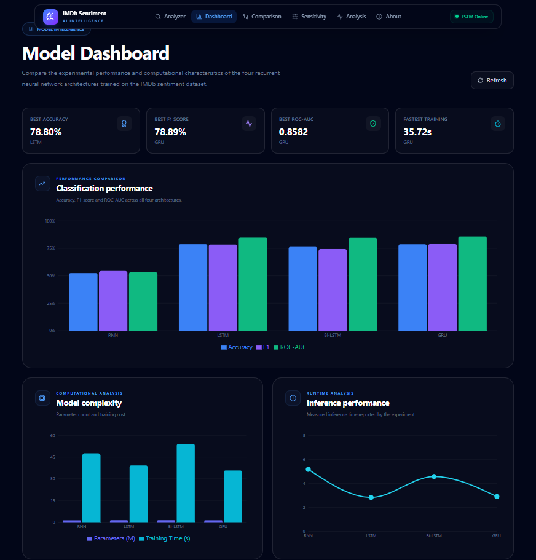
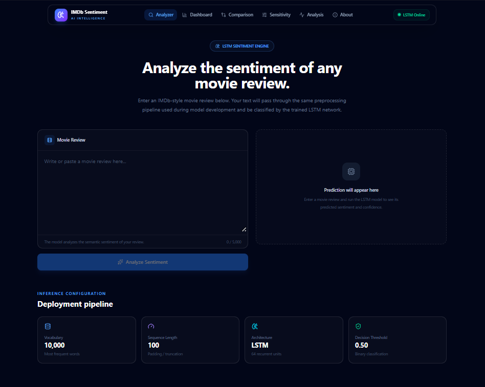
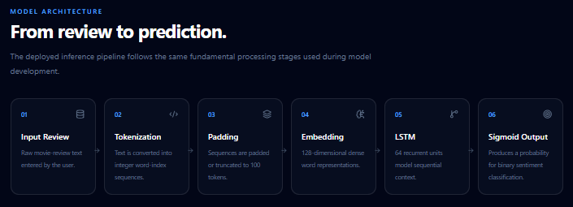
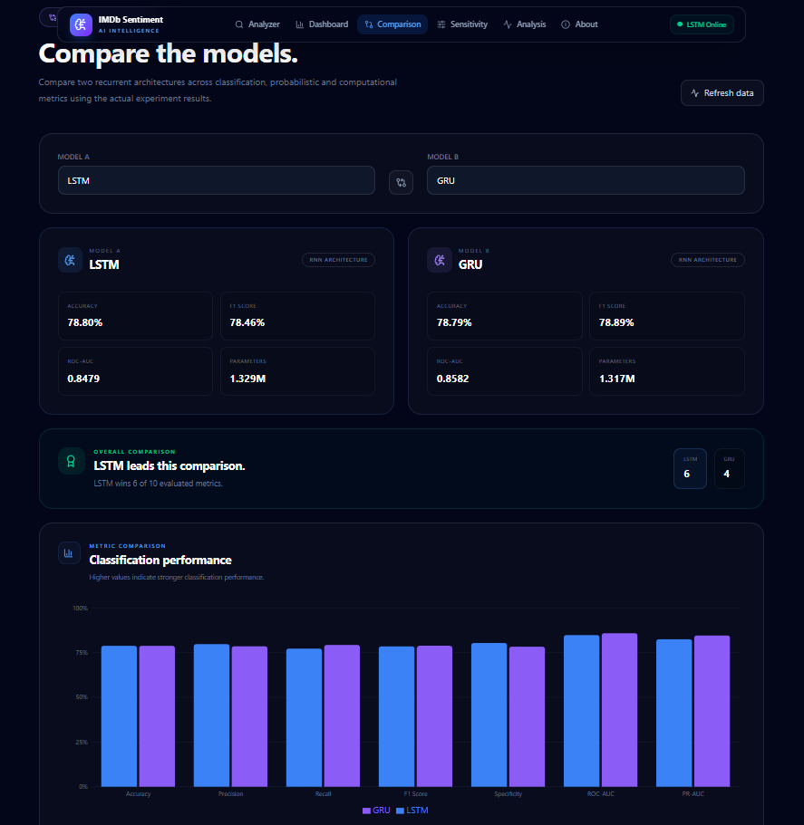
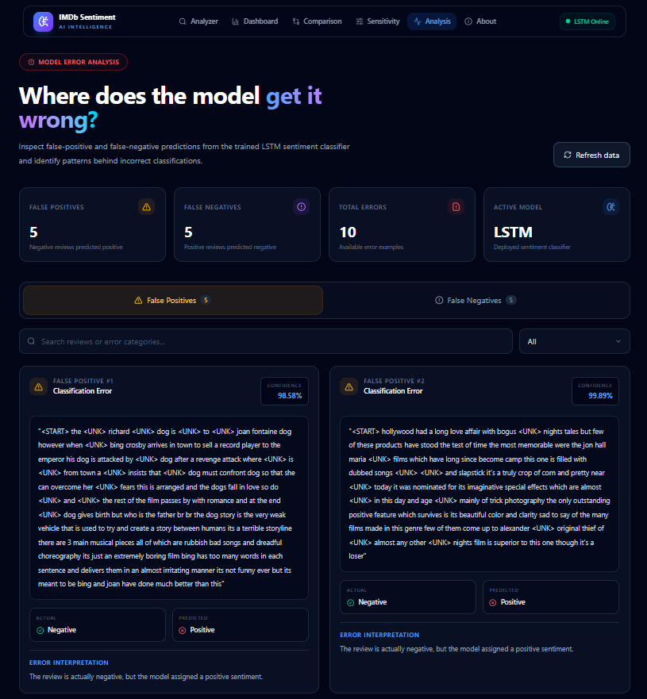
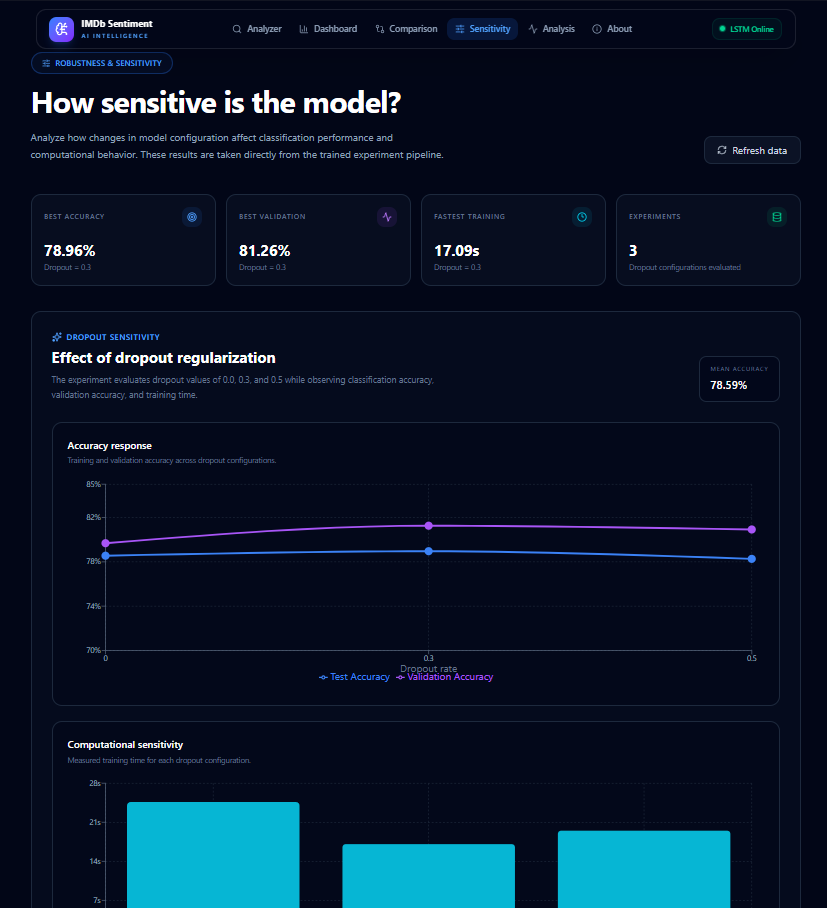

<div align="center">

# 🎬 IMDb Sentiment Intelligence

### Deep Learning Based Sentiment Classification Using Recurrent Neural Networks

<p>
  <strong>TensorFlow • Keras • RNN • LSTM • Bi-LSTM • GRU • FastAPI • React • Vite • Tailwind CSS</strong>
</p>

<p>
  An end-to-end NLP and Deep Learning application for classifying IMDb movie reviews
  as <strong>Positive</strong> or <strong>Negative</strong>, with interactive prediction,
  model comparison, analytics, error analysis and sensitivity analysis.
</p>

<br>


<br>


</div>

---

## 📸 Application Preview

<div align="center">

### 🖥️ Analytics Dashboard



<br><br>

### 🔍 Sentiment Analyzer



</div>

---

## 🧭 Navigation

- [Project Overview](#-project-overview)
- [Key Features](#-key-features)
- [System Architecture](#-system-architecture)
- [Machine Learning Pipeline](#-machine-learning-pipeline)
- [Model Performance](#-model-performance)
- [Deployed LSTM](#-deployed-lstm)
- [Web Application](#-web-application)
- [Error Analysis](#-error-analysis)
- [Sensitivity Analysis](#-sensitivity-analysis)
- [REST API](#-rest-api)
- [Technology Stack](#-technology-stack)
- [Project Structure](#-project-structure)
- [Installation](#-installation)
- [Experimental Findings](#-experimental-findings)
- [Limitations](#-limitations)
- [Future Improvements](#-future-improvements)

---

# 📌 Project Overview

**IMDb Sentiment Intelligence** is an end-to-end Deep Learning and NLP project developed to study, compare and deploy recurrent neural network architectures for binary sentiment classification.

The system takes a natural-language movie review and predicts:

- **Positive / Negative sentiment**
- **Prediction probability**
- **Positive probability**
- **Negative probability**
- **Inference information**

The project goes beyond a simple classifier by combining:

> **Model Development → Architecture Comparison → Evaluation → Sensitivity Analysis → Error Analysis → API Deployment → Interactive Web Application**

The IMDb dataset is processed using a fixed vocabulary of **10,000 words** and a maximum sequence length of **100 tokens**. Four recurrent architectures are trained under a common experimental setup:

- Simple RNN
- LSTM
- Bidirectional LSTM
- GRU

---

# ✨ Key Features

### 🤖 Deep Learning
- Four recurrent architectures trained and compared.
- Keras Embedding layer for numerical text representation.
- Binary sentiment classification using sigmoid output.
- Reproducible preprocessing and model configuration.

### 📊 Model Evaluation
- Accuracy
- F1 Score
- ROC-AUC
- PR-AUC
- Matthews Correlation Coefficient
- Brier Score
- Log Loss
- Parameter count
- Training time

### 🧪 Model Analysis
- False Positive analysis
- False Negative analysis
- Sarcasm and negation analysis
- Mixed sentiment analysis
- Dropout sensitivity analysis
- Computational comparison

### 🌐 Deployment
- FastAPI REST backend
- React + Vite frontend
- Interactive sentiment analyzer
- Analytics dashboard
- Model comparison dashboard
- Error analysis interface
- Sensitivity analysis interface
- Production frontend build

---

# 🏗️ System Architecture

<div align="center">



</div>

The system follows a layered architecture:

```text
┌──────────────────────────────────────────────────────────┐
│                    React Frontend                        │
│ Analyzer • Dashboard • Comparison • Analysis • About    │
└───────────────────────────┬──────────────────────────────┘
                            │ REST API
                            ▼
┌──────────────────────────────────────────────────────────┐
│                    FastAPI Backend                       │
│ Prediction • Model Info • Analytics • Error Analysis    │
└───────────────────────────┬──────────────────────────────┘
                            │
                            ▼
┌──────────────────────────────────────────────────────────┐
│                 LSTM Inference Pipeline                  │
│ Preprocessing → Embedding → LSTM → Dropout → Sigmoid    │
└───────────────────────────┬──────────────────────────────┘
                            │
                            ▼
┌──────────────────────────────────────────────────────────┐
│                    Model Artifacts                       │
│ Keras Model • IMDb Word Index • Deployment Config       │
└──────────────────────────────────────────────────────────┘
```

---

# 🧠 Machine Learning Pipeline

```text
                    ┌──────────────────────┐
                    │     IMDb Dataset     │
                    │    50,000 Reviews    │
                    └──────────┬───────────┘
                               │
                               ▼
                    ┌──────────────────────┐
                    │  Text Representation │
                    │ Tokenization / Index  │
                    └──────────┬───────────┘
                               │
                               ▼
                    ┌──────────────────────┐
                    │ Vocabulary Filtering │
                    │      10,000 words    │
                    └──────────┬───────────┘
                               │
                               ▼
                    ┌──────────────────────┐
                    │ Padding / Truncation │
                    │    Length = 100      │
                    └──────────┬───────────┘
                               │
                               ▼
             ┌────────────────────────────────────┐
             │       Recurrent Architectures      │
             │                                    │
             │  RNN │ LSTM │ Bi-LSTM │ GRU        │
             └────────────────┬───────────────────┘
                              │
                              ▼
                    ┌──────────────────────┐
                    │   Model Evaluation   │
                    │ Accuracy / F1 / AUC  │
                    │ PR-AUC / MCC / etc.  │
                    └──────────┬───────────┘
                               │
                               ▼
                    ┌──────────────────────┐
                    │   Model Selection    │
                    │       LSTM           │
                    └──────────┬───────────┘
                               │
                               ▼
                    ┌──────────────────────┐
                    │    FastAPI Backend   │
                    └──────────┬───────────┘
                               │
                               ▼
                    ┌──────────────────────┐
                    │    React Frontend    │
                    └──────────────────────┘
```

---

# 🔤 Data & Preprocessing

## Dataset

The project uses the **Keras IMDb movie review dataset**:

| Property | Value |
|---|---:|
| Total Reviews | 50,000 |
| Training Reviews | 25,000 |
| Testing Reviews | 25,000 |
| Classes | 2 |
| Classes | Positive / Negative |
| Vocabulary | 10,000 |
| Maximum Sequence Length | 100 |

## Preprocessing Flow

```text
Raw Review
    ↓
Token / Word Index Conversion
    ↓
Special Token Handling
    ↓
Vocabulary Filtering
    ↓
Integer Sequence
    ↓
Post Padding / Truncation
    ↓
Fixed Length = 100
    ↓
Embedding Layer
```

The deployment preprocessing reproduces the same core assumptions used during training. This is essential because the trained neural network expects a fixed-size numerical sequence.

### Padding and Truncation

- Reviews shorter than 100 tokens are padded.
- Reviews longer than 100 tokens are truncated.
- Padding strategy: `post`
- Truncation strategy: `post`

---

# 🧬 Model Architectures

Four recurrent architectures were evaluated.

## 1. Simple RNN

```text
Input
  ↓
Embedding
  ↓
Simple RNN
  ↓
Dropout
  ↓
Dense + Sigmoid
```

Provides the baseline recurrent architecture but is more vulnerable to vanishing-gradient effects.

## 2. LSTM

```text
Input
  ↓
Embedding
  ↓
LSTM
  ↓
Dropout
  ↓
Dense + Sigmoid
```

LSTM uses gated memory cells to retain useful information across longer sequences.

## 3. Bidirectional LSTM

```text
              ┌── Forward LSTM ──┐
Input ────────┤                  ├── Output
              └─ Backward LSTM ──┘
```

Processes the sequence in both directions and can capture information from both past and future context.

## 4. GRU

```text
Input
  ↓
Embedding
  ↓
GRU
  ↓
Dropout
  ↓
Dense + Sigmoid
```

GRU uses a simplified gating mechanism and achieved competitive performance with fewer parameters than LSTM.

---

# 📈 Model Performance

## Final Comparison

<div align="center">

| Model | Accuracy | F1 Score | ROC-AUC | Parameters | Training Time |
|:---|---:|---:|---:|---:|---:|
| 🏆 **LSTM** | **78.80%** | 78.46% | 0.8479 | 1,329,473 | 39.19s |
| ⚡ **GRU** | 78.79% | **78.89%** | **0.8582** | **1,317,313** | **35.72s** |
| Bi-LSTM | 76.30% | 74.40% | 0.8462 | 1,378,945 | 54.02s |
| Simple RNN | 52.48% | 54.44% | 0.5319 | 1,292,417 | 47.54s |

</div>

### Performance Interpretation

- **LSTM** achieved the highest test accuracy and was selected for deployment.
- **GRU** achieved the highest F1 and ROC-AUC while using fewer parameters and less training time.
- **Bi-LSTM** did not outperform the unidirectional LSTM in this experiment.
- **Simple RNN** performed substantially worse than the gated architectures.

> The deployment choice reflects the project's final model-selection procedure, where LSTM was selected based on the overall ranking/accuracy decision.

---

# 🏆 Deployed LSTM

The deployed model uses the following configuration:

| Configuration | Value |
|---|---|
| Model | LSTM |
| Vocabulary Size | 10,000 |
| Maximum Sequence Length | 100 |
| Embedding Dimension | 128 |
| LSTM Units | 64 |
| Dropout | 0.30 |
| Optimizer | Adam |
| Learning Rate | 0.001 |
| Loss | Binary Cross-Entropy |
| Output Activation | Sigmoid |
| Classification Threshold | 0.50 |
| Padding | Post |
| Truncation | Post |

## Evaluation Metrics

| Metric | Score |
|---|---:|
| Accuracy | **78.80%** |
| F1 Score | **78.46%** |
| ROC-AUC | **0.8479** |
| PR-AUC | **0.8244** |
| MCC | **0.576** |
| Brier Score | **0.1881** |
| Log Loss | **0.9148** |

---

# 🖥️ Web Application

The project provides a multi-page AI analytics interface instead of a basic prediction form.

## 🔍 Sentiment Analyzer

Users can enter a movie review and receive a real-time sentiment prediction.

<div align="center">


</div>

The analyzer provides:

- Predicted sentiment
- Confidence / prediction probability
- Positive probability
- Negative probability
- Inference information

---

## 📊 Analytics Dashboard

<div align="center">


</div>

The dashboard presents the deployed model and experimental results in an interactive interface.

It includes:

- Model performance
- Evaluation metrics
- Dataset information
- Model configuration
- Training information
- Deployment information

---

## ⚖️ Model Comparison

<div align="center">



</div>

The comparison page evaluates all four architectures using:

- Accuracy
- F1 Score
- ROC-AUC
- Parameter count
- Training time

---

## ❌ Error Analysis

<div align="center">



</div>

The application provides dedicated False Positive and False Negative analysis.

The analyzed error categories include:

- Negation
- Sarcasm
- Mixed sentiment
- Ambiguity
- Context-dependent language
- Long-review context

The project includes at least:

- 5 False Positive examples
- 5 False Negative examples

---

## 🧪 Sensitivity Analysis

<div align="center">



</div>

The implemented sensitivity experiment investigates the effect of dropout on:

- Test accuracy
- Validation accuracy
- Training time
- Parameter count

### Dropout Results

| Dropout | Test Accuracy | Validation Accuracy | Training Time |
|---:|---:|---:|---:|
| 0.0 | 78.55% | 79.68% | 24.64s |
| **0.3** | **78.96%** | **81.26%** | **17.09s** |
| 0.5 | 78.27% | 80.92% | 19.50s |

Among the tested dropout configurations, **0.3 produced the strongest accuracy and validation accuracy while also recording the fastest training time in this experiment**.

---

# 🔬 Error Analysis

The model does not classify every review correctly. Difficult cases often involve language where sentiment depends on context rather than isolated positive or negative words.

### Negation

```text
"The movie was not nearly as good as expected."
```

### Sarcasm

```text
"Brilliant! Exactly how I wanted to waste two hours."
```

### Mixed Sentiment

```text
"The acting was excellent, but the story was painfully slow."
```

### Ambiguity

Some reviews contain language that can reasonably support multiple sentiment interpretations.

### Long Context

The baseline sequence length is limited to 100 tokens. Important information occurring later in a long review can therefore be truncated.

---

# 🔌 REST API

The backend is implemented using **FastAPI**.

## Core Endpoints

| Method | Endpoint | Purpose |
|---|---|---|
| GET | `/` | API information |
| GET | `/health` | Health check |
| POST | `/predict` | Sentiment prediction |
| GET | `/model` | Deployed model information |
| GET | `/comparison` | Model comparison |
| GET | `/ranking` | Model ranking |
| GET | `/training` | Training results |
| GET | `/errors` | Error analysis |
| GET | `/sensitivity` | Sensitivity experiments |

## Prediction Request

```http
POST /predict
Content-Type: application/json
```

```json
{
  "review": "This movie was absolutely fantastic."
}
```

## Example Response

```json
{
  "sentiment": "Positive",
  "probability": 0.997,
  "positive_probability": 0.997,
  "negative_probability": 0.003
}
```

The API documentation is available through FastAPI's Swagger interface:

```text
http://127.0.0.1:8000/docs
```

---

# 🧩 Technology Stack

## Machine Learning & Data

- Python
- TensorFlow
- Keras
- NumPy
- Pandas
- Scikit-learn

## Deep Learning

- Simple RNN
- LSTM
- Bidirectional LSTM
- GRU
- Embedding
- Dropout
- Sigmoid classification

## Backend

- FastAPI
- Uvicorn
- Pydantic

## Frontend

- React
- Vite
- Tailwind CSS
- Axios
- React Router
- Recharts
- Lucide React

## Development

- Google Colab
- Visual Studio Code
- Git
- GitHub

---

# 📁 Project Structure

```text
IMDb-Sentiment-AI/
│
├── Backend/
│   ├── app/
│   │   ├── main.py
│   │   ├── model.py
│   │   ├── preprocessing.py
│   │   ├── schemas.py
│   │   └── analytics.py
│   │
│   ├── models/
│   │   └── best_sentiment_model.keras
│   │
│   ├── data/
│   │   └── imdb_word_index.pkl
│   │
│   ├── results/
│   │   ├── final_model_comparison.csv
│   │   ├── model_ranking.csv
│   │   ├── training_results.csv
│   │   ├── model_evaluation_results.csv
│   │   ├── computational_results.csv
│   │   ├── error_analysis.csv
│   │   └── sensitivity_*.csv
│   │
│   ├── deployment_config.json
│   └── requirements.txt
│
├── Frontend/
│   ├── src/
│   │   ├── components/
│   │   │   ├── Navbar.jsx
│   │   │   ├── Hero.jsx
│   │   │   ├── ReviewInput.jsx
│   │   │   ├── SentimentResult.jsx
│   │   │   ├── MetricCard.jsx
│   │   │   └── LoadingState.jsx
│   │   │
│   │   ├── pages/
│   │   │   ├── Home.jsx
│   │   │   ├── Analyzer.jsx
│   │   │   ├── Dashboard.jsx
│   │   │   ├── ModelComparison.jsx
│   │   │   ├── ErrorAnalysis.jsx
│   │   │   ├── Sensitivity.jsx
│   │   │   └── About.jsx
│   │   │
│   │   ├── services/
│   │   │   └── api.js
│   │   │
│   │   ├── App.jsx
│   │   ├── main.jsx
│   │   └── index.css
│   │
│   ├── package.json
│   ├── package-lock.json
│   └── vite.config.js
│
├── docs/
│   └── images/
│       ├── analyzer.png
│       ├── architecture.png
│       ├── comparison.png
│       ├── dashboard.png
│       ├── error-analysis.png
│       └── sensitivity.png
│
├── README.md
└── .gitignore
```

> **Important:** `venv/`, `node_modules/`, `dist/`, cache files and other environment-specific artifacts should not be committed to Git.

---

# ⚙️ Installation

## Prerequisites

Install the following:

```text
Python 3.10+
Node.js 18+
npm
Git
```

---

## 1. Clone the Repository

```bash
git clone https://github.com/Anubhab47677/IMDb-Sentiment-AI.git
cd IMDb-Sentiment-AI
```

> If the repository URL changes, replace the URL above with the final repository URL.

---

# 🐍 Backend Setup

Open a terminal:

```bash
cd Backend
```

Create a virtual environment:

```bash
python -m venv venv
```

Activate it on Windows:

```powershell
.\venv\Scripts\activate
```

Install dependencies:

```bash
pip install -r requirements.txt
```

Start the FastAPI server:

```bash
uvicorn app.main:app --reload
```

Backend:

```text
http://127.0.0.1:8000
```

Swagger documentation:

```text
http://127.0.0.1:8000/docs
```

---

# ⚛️ Frontend Setup

Open another terminal:

```bash
cd Frontend
```

Install dependencies:

```bash
npm install
```

Start the development server:

```bash
npm run dev
```

Frontend:

```text
http://localhost:5173
```

---

# 🔄 Run the Complete Application

### Terminal 1 — Backend

```powershell
cd Backend
.\venv\Scripts\activate
uvicorn app.main:app --reload
```

### Terminal 2 — Frontend

```bash
cd Frontend
npm install
npm run dev
```

Then open:

```text
http://localhost:5173
```

The React frontend communicates with the FastAPI backend through REST API requests.

---

# 🏭 Production Build

To create the production frontend bundle:

```bash
cd Frontend
npm run build
```

The production output is generated in:

```text
Frontend/dist/
```

The project has been successfully verified with a Vite production build.

---

# 🧪 Example Predictions

## Positive Review

```text
The movie was absolutely fantastic. The performances were
brilliant and the story kept me engaged throughout.
```

Expected:

```text
Positive
```

## Negative Review

```text
This movie was extremely disappointing. The story was weak
and the characters were poorly written.
```

Expected:

```text
Negative
```

The application returns the predicted sentiment together with its probability distribution.

---

# 📊 Experimental Findings

### Finding 1 — Gated RNNs outperform the Simple RNN

LSTM, GRU and Bi-LSTM substantially outperform the basic Simple RNN in this experiment.

### Finding 2 — GRU provides an efficient trade-off

GRU achieved the highest F1 and ROC-AUC among the tested models while using fewer parameters and less training time than LSTM.

### Finding 3 — LSTM achieved the highest accuracy

LSTM achieved the highest test accuracy among the four architectures and was selected for deployment according to the project's final selection procedure.

### Finding 4 — Dropout affects generalization

The sensitivity experiment identified `0.3` dropout as the strongest tested configuration.

### Finding 5 — Accuracy alone is insufficient

The project evaluates multiple dimensions of model quality:

```text
Accuracy
F1 Score
ROC-AUC
PR-AUC
MCC
Brier Score
Log Loss
Training Time
Parameter Count
```

This provides a broader view of predictive quality and computational cost.

---

# ⚠️ Limitations

- Maximum sequence length is limited to 100 tokens.
- The dataset is restricted to movie-review sentiment.
- The current model uses a relatively simple embedding + recurrent architecture.
- Sarcasm and complex contextual sentiment remain challenging.
- Transformer-based models are not included in the current architecture comparison.
- The model is not continuously retrained.
- The current application is primarily designed for local deployment.
- Sensitivity experiments are limited to the configurations implemented in the project.

---

# 🚀 Future Improvements

- [ ] Bidirectional GRU
- [ ] Attention-based RNN
- [ ] Transformer-based sentiment classifier
- [ ] BERT / DistilBERT comparison
- [ ] Larger vocabulary experiments
- [ ] Dynamic sequence-length experiments
- [ ] Automated hyperparameter optimization
- [ ] Advanced probability calibration
- [ ] Explainable AI / attention visualization
- [ ] Docker deployment
- [ ] Cloud deployment
- [ ] Authentication and authorization
- [ ] Persistent prediction history
- [ ] Real-time monitoring
- [ ] CI/CD pipeline
- [ ] Automated model retraining

---

# 🔐 Production Deployment Considerations

A production version could extend the current architecture as follows:

```text
                    React Frontend
                           │
                           ▼
                 Reverse Proxy / CDN
                           │
                           ▼
                    FastAPI Service
                    ┌──────┼──────┐
                    ▼      ▼      ▼
                 Model  Validation Logs
                 Service
                    │
                    ▼
              Monitoring Layer
```

Recommended production improvements:

- HTTPS
- Request validation
- Rate limiting
- Structured logging
- Health checks
- Model versioning
- Monitoring
- Containerization
- CI/CD
- Cloud deployment

---

# 📚 Academic Context

This project was developed as part of a Deep Learning laboratory assignment focused on:

- Natural Language Processing
- Sentiment Classification
- Integer Encoding
- Word Embeddings
- Padding and Truncation
- Recurrent Neural Networks
- LSTM
- GRU
- Bidirectional LSTM
- Classification Metrics
- Probabilistic Metrics
- Computational Analysis
- Sensitivity Analysis
- Error Analysis
- Model Deployment

The implementation extends the experimental model-building workflow into a complete interactive web-based AI system.

---

# 🧭 End-to-End Workflow

```text
                         DATA
                          │
                          ▼
                 IMDb Movie Reviews
                          │
                          ▼
                  Preprocessing
                          │
                          ▼
               Integer Representation
                          │
                          ▼
                Padding / Truncation
                          │
                          ▼
          ┌───────────────┼───────────────┐
          │               │               │
          ▼               ▼               ▼
         RNN             LSTM            GRU
                          │
                          ▼
                       Bi-LSTM
                          │
                          ▼
                  Model Evaluation
                          │
             ┌────────────┼────────────┐
             │            │            │
             ▼            ▼            ▼
          Metrics       Error      Sensitivity
          Analysis      Analysis    Analysis
             │            │            │
             └────────────┼────────────┘
                          ▼
                   Model Selection
                          │
                          ▼
                    LSTM Model
                          │
                          ▼
                     FastAPI
                          │
                          ▼
                  React Frontend
                          │
                          ▼
               Interactive AI System
```

---

# 💡 Key Takeaways

> **This project is more than a sentiment classifier.**

It demonstrates the complete lifecycle of an NLP Deep Learning system:

```text
Dataset
   ↓
Preprocessing
   ↓
Model Development
   ↓
Architecture Comparison
   ↓
Evaluation
   ↓
Sensitivity Analysis
   ↓
Error Analysis
   ↓
Model Selection
   ↓
API Deployment
   ↓
Interactive Web Application
```

The project therefore demonstrates both:

**Deep Learning experimentation**  
and  
**Practical ML application deployment**

---

# 👨‍💻 Author

<div align="center">

### Anubhab Samantaray

**B.Tech — Computer Science & Engineering**  
**Artificial Intelligence & Machine Learning**

</div>

---

# ⭐ Project Highlights

<div align="center">

| Category | Highlights |
|---|---|
| Dataset | 50,000 IMDb Reviews |
| Architectures | RNN • LSTM • Bi-LSTM • GRU |
| Vocabulary | 10,000 words |
| Embedding | 128 dimensions |
| Deployed Model | LSTM |
| Backend | FastAPI |
| Frontend | React + Vite |
| UI | Tailwind CSS |
| Analytics | Comparison • Error • Sensitivity |
| API | REST + Swagger |
| Deployment | Local production-ready build |

</div>

---

<div align="center">

### ⭐ If you found this project interesting, consider starring the repository.

**IMDb Sentiment Intelligence — From NLP Experimentation to Deployment**

</div>
